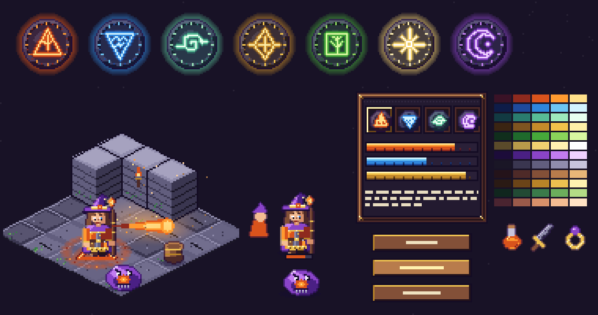
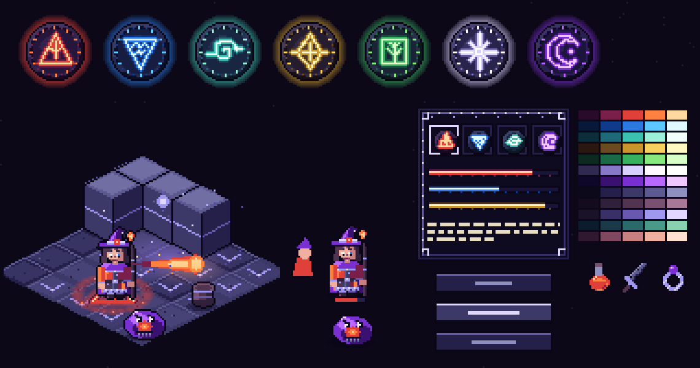
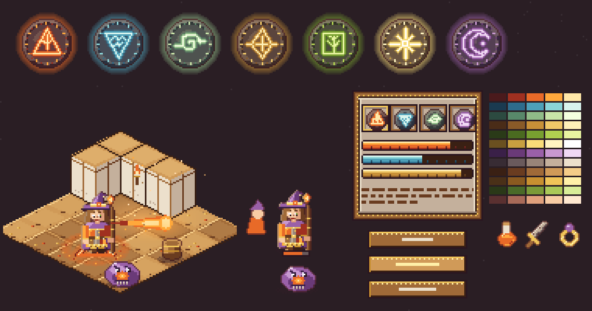
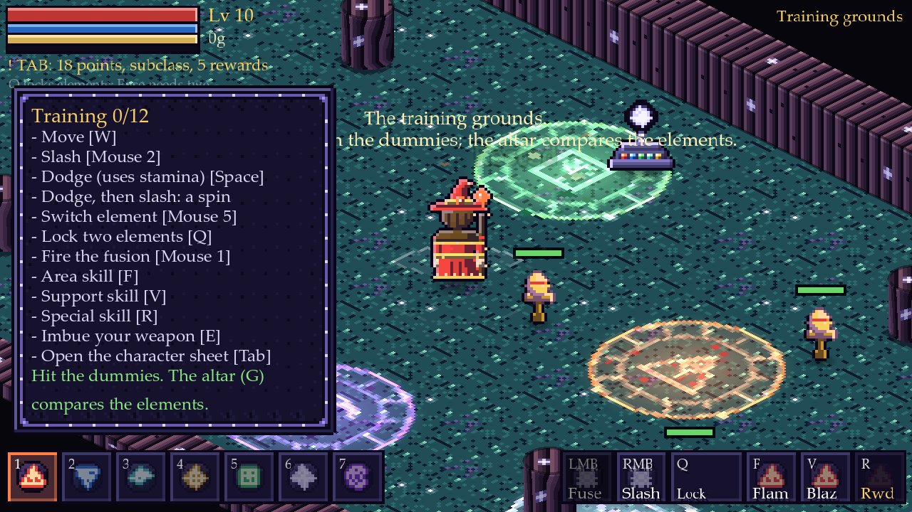
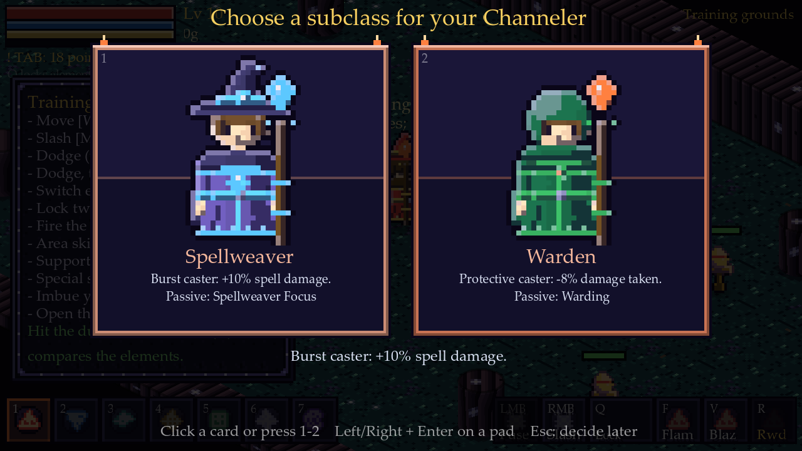
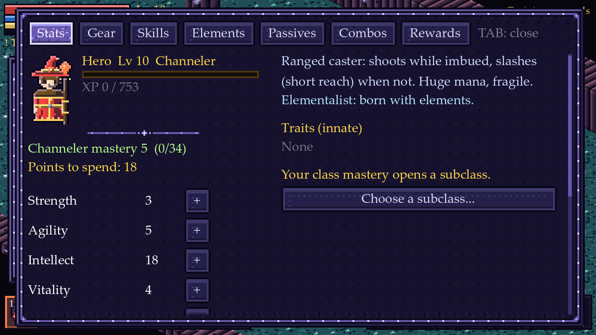
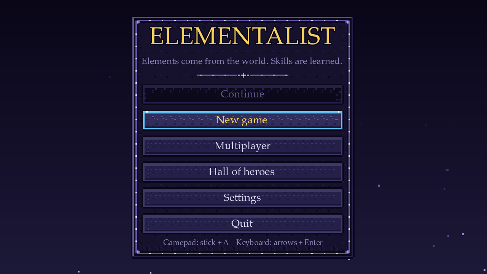
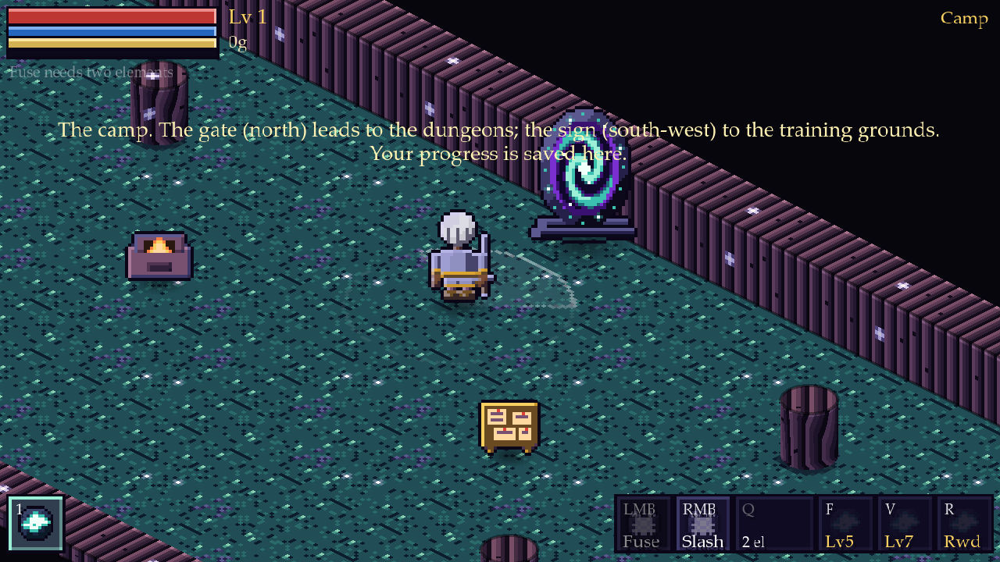
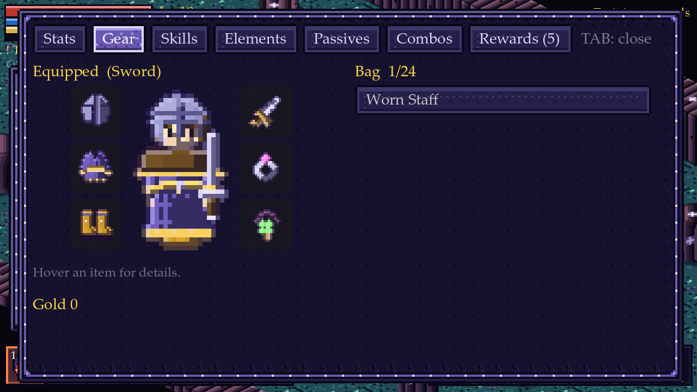
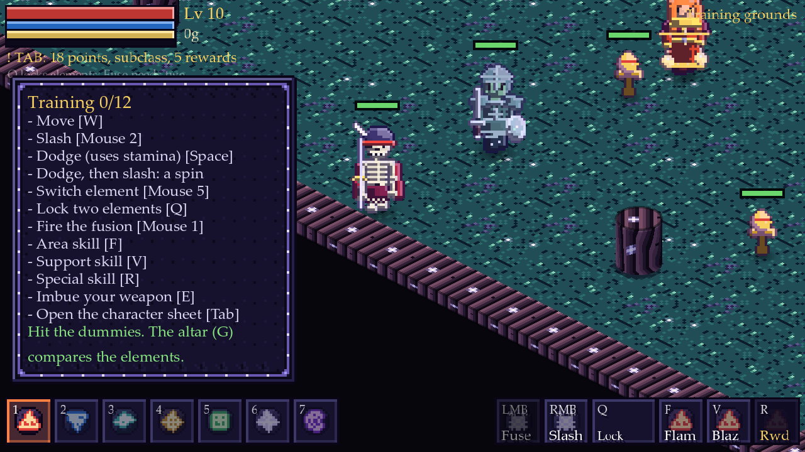

# Art direction: Moonlit Glyphwork

Status: **chosen and applied.** Of the three proposals (Gilded Hollow, Moonlit Glyphwork, Autumn Storybook) the project uses
**Moonlit Glyphwork**. Every picture in the game is still drawn by the scripts in `tools/art` (standard library only), so the style
is code: `tools/art/style.py` holds the palette ramps, the rune renderer and the outline rule; `python tools/art/build_all.py`
rebuilds all art and runs the art gate. The two other styles stay in `style.py` and in the comparison boards (`docs/art/style_*.png`,
`python tools/art/style_board.py [gilded|moonlit|storybook]`) in case a campaign area wants a different mood later.

| | A. Gilded Hollow | **B. Moonlit Glyphwork (chosen)** | C. Autumn Storybook |
|---|---|---|---|
| Board |  |  |  |
| Mood | Jewel-toned, carved, a candlelit crypt | Cold, deep, everything magic glows | Warm, cosy, painted, a lantern-lit inn |
| Outline | Dark shade of the colour it touches | One ink line everywhere | Warm brown |
| UI | Carved wood, brass studs | Obsidian slab with a thin glowing rune border | Stitched leather around parchment |

## What the style is

* **A cold world with emissive magic.** Floors, walls, props and the UI are deep blue-violet obsidian; colour is spent on what the player
  must read: elements, bolts, runes, bars, loot. A glow is always a recipe: white-hot core, saturated body, dark halo, coloured outer glow.
* **Ramps, not colours.** Twelve five-step ramps (`style.STYLES["moonlit"]["ramps"]`): fire, water, air, mineral, earth, light, dark, stone,
  wood, brass (cold metal), moss and skin. Shadows lean cool, lights lean warm-pale. No pure black or white: the ink is `0a0618`.
* **Two outline rules.** Backgrounds, props, runes and UI keep the single ink line (`0a0618`). Characters, monsters and equipment use a **selective
  outline** (a deep, violet-leaning shade of the colour they border), the soft look of cosy village RPGs, and characters also get a moonlit rim
  (`d8d0ff`) on the lit upper-left edge. (The first Moonlit pass used ink for everything; the character references asked for the softer rule.)
* **Light from the upper left** in every picture: bevels, runes, wall faces, hero shading.
* **Calm floors, busy things.** Floors keep their glow low (rune seams in the place's element colour, never brighter than a bolt), so sprites
  always read on top.

## What changed in the game

1. **Elements are runes.** A carved dark disc, an inscribed ring with tick marks and an angular glowing glyph: fire a rising triangle, water a
   falling triangle, air a spiral, mineral a cut diamond, earth a square with a sprout, light eight rays, dark a crescent; martial (not an
   element) is two crossed blades. Made by `gen_runes.py` in three sizes (`assets/ui/rune_<element>_{s,m,l}.png`: 18, 30 and 40 px) and
   shown by `UiTheme.rune(element, size)` on the hotbar, the skill slots, the reward cards and the character sheet. Area skills draw the
   element's own rune circle on the floor (`fx_rune_<element>`), turning while the area lasts.
2. **Element colours are one table.** `Elements.COLORS` holds the bright step of each ramp (fire `ff8040`, water `5cc8ff`, air `9cf0d8`,
   mineral `f8d060`, earth `88e880`, light `e8e0ff`, dark `b868ff`, martial `b8b8d8`); bolts, rings, particles, hotbar, damage numbers and
   cards all read it, and a self-test pins the values.
3. **VFX** (`gen_vfx.py`): bolts are 18 x 11 glow-recipe sprites with an element-shaped head (flame, droplet, wind streaks, shard, thorn, star,
   void orb, knife); hits, slashes and rune circles stay white and are tinted by code.
4. **UI and HUD** (`gen_ui.py`, `ui_theme.gd`, `hud.gd`, `card_frame.gd`): obsidian 9-slice panels with a rune line that has a lit glint every 8 px,
   slab buttons that glow when hovered or focused, slim glowing bars with a lit top line and bright tip, hotbar slots as slabs with the
   element rune behind the key and name, amber for what matters (`UiTheme.GOLD`). Layout did not move.
5. **Heroes are 24 x 38 with natural proportions** (a head about a quarter of the height, a neck, shoulders, a waist, arms ending in hands, legs
   ending in shoes; they were 16 x 26 and chibi): a face with brows, eyes, nose, mouth and cheek light, hair with volume and highlight clusters,
   a hat with band and gem, a mantle, a robe with an open front and rune hem, belts with buckles and pouches, cuffed sleeves, boots with soles and
   cuffs, pauldrons, quivers, horns and antlers, and weapons with guards, bands and glowing gems. Still parts with region/shade pixels, so every class, subclass and piece of gear recolours them;
   `HeroComposer` adds the ink outline and the rim. Class cards show them at 1x (eight in a row), subclass cards at 2x.
6. **Humanoid enemies are drawn on the hero rig** (`gen_enemies.py`): the skeleton archer, bone duelist, grave warden, ember matron, wraith and shade share the
   hero's anatomy, 24 x 38 frame, shading ramp, moonlit rim and selective outline, in four walking frames. Enemy-only parts (skull, ribcage and bone limbs,
   shield, flame crown, ghost cloak) live in that file; armour, caps, capes, weapons and the body are the hero's own parts. Their hit boxes keep the sizes of
   the smaller drawings they replaced (`Enemy.BODY_SIZES`), and health bars float above the taller picture.
6a. **The other monsters and bosses** keep their drawings but get soft outlines and rounded volume (`restyle.pillow` and `restyle.volumize`: a height field from
   the silhouette lit from the upper left, a lit rim and a shaded underside) and are snapped to the ramps. Props pass through `restyle.py`; the altar
   was redrawn with the five element glyphs and a floating light rune.
6b. **Equipment** has its own 16 x 16 painted icon per gear base (`gen_items.py` -> `item_<base>.png`: swords, daggers, axes, staves, rods, bows, tomes,
   tunic, mail, robe, cap, helm, hood, shoes, boots, rings, amulets), drawn with five tones, a lit top-left and the selective outline in the same
   material colours the hero wears them in. The equipment screen and the floor drops show them.
6c. **Portals.** The camp's dungeon gate is a standing stone ring with an animated rune swirl (`portal_gate_strip.png`, 6 frames) and an opened room exit
   is a row of turning portal pads (`door_open_strip.png`), both from `gen_portal.py`; they replace the old green-barred square.
7. **Places** (`gen_tiles.py`): six themes of obsidian tinted per place (vault amber, crypt teal, hollow green, ember crimson, spire violet,
   camp a moonlit clearing) with rune seams and glyphs in the place's element colour, glowing wall glyphs, pillars with a rune ring, starry voids.

## In the game

| | |
|---|---|
|  |  |
|  |  |
|  |  |
|  | |

## Tools

| Script | Writes |
|---|---|
| `tools/art/build_all.py` | runs everything below in order, then `check_art.py` |
| `style.py` | the palettes, `rune()`, `outline()`, glow and shadow helpers (not a generator) |
| `restyle.py` | snaps a finished sprite onto the ramps (used by `gen_sprites.py`) |
| `gen_runes.py` | `assets/ui/rune_*.png` |
| `gen_vfx.py` | `proj_*`, `fx_hit`, `fx_slash`, `fx_rune`, `fx_rune_<element>` |
| `gen_ui.py` | `assets/ui/*.png` (9-slice frames) |
| `gen_tiles.py` | `tile_*`, `bg_*` per theme |
| `gen_heroes.py` | `assets/sprites/hero/<part>_<variant>_<facing>.png` (24 x 38 frames) |
| `gen_sprites.py` | monsters, bosses, props, pickups |
| `gen_enemies.py` | the six humanoid enemies on the hero rig |
| `gen_items.py` | `item_<base>.png`, the 26 equipment icons |
| `gen_portal.py` | `portal_gate_strip.png`, `door_open_strip.png` |
| `preview_heroes.py`, `preview.py`, `preview_tiles.py` | contact sheets for eyeballing |
| `check_art.py` | the art gate |

## Acceptance gates (all enforced)

* `python tools/art/check_art.py`: no pure black or white anywhere (except the white pictures the game tints), monsters, bosses and props use only
  Moonlit ramp colours plus the ink, hero parts keep the region/shade encoding and are 4 frames of 24 x 38.
* `tests/combo_selftest.gd` `_test_art_style`: the element colours are the ramp colours, every element has its runes, bolt and rune circle, heroes are
  24 x 38, no hero part of any kind is clipped by its frame in any facing or frame, every hero is inked.
* All earlier self-tests stay green (the creation screen and the cards still fit the 320 x 180 view with the larger heroes).

## Known gaps and next steps

* The non-humanoid monsters (slime, bat, wisp, brute, spitter, imp, sapling, wolf, slug, hulk) and the bosses are softened and rounded, not redrawn: they match
  the style but are not as detailed as the heroes. The lich and the sovereign are humanoid but bigger than the 24 x 38 rig, so they need a larger canvas.
* Icons exist for gear; potions, materials and gems still use the generic tinted pickup pictures.
* The floating glyph lantern and per-theme props are not drawn yet; torchlight pools (`style.light_pool`) are not used in-game.
* Hero walk cycles keep the old 4-frame bob; a richer cycle (arm swing is in, but no cape physics) would be a later polish.

## References and provenance

Six reference images (an elemental emblem set, a painterly top-down action scene, two cosy isometric village scenes, an isometric autumn scene
and an isometric farm scene) were studied for technique only: ramps, outlines, light pools and block faces. No shape, character, prop or
layout is copied, none of the images is stored here, and every picture in the repository is drawn by the scripts in `tools/art`.
