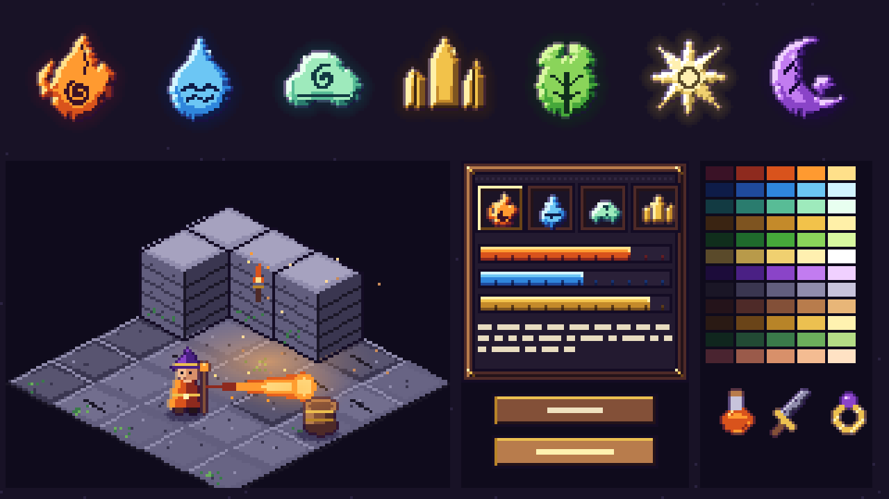

# Art direction: "Gilded Hollow" (proposal)

Status: **proposed, not yet applied to the game.** The board below is drawn by code (`tools/art/style.py`,
`tools/art/style_board.py`), so the real restyle can reuse the same functions. Run `python tools/art/style_board.py`
to redraw it.

Board, left to right and top to bottom: the seven element emblems; an isometric dungeon corner with a hero, a spell, a
barrel and torchlight; the UI kit (frame, hotbar with emblems, resource bars, buttons, text blocks); the colour ramps
and three item icons (potion, sword, ring).

## What the six references teach (and what we do not take)

The references are mood and technique only. No shape, character, prop or layout is copied.

| Reference | Technique we take |
|---|---|
| Elemental emblem set | One chunky silhouette per element, a bevelled gem look, carved interior line work, a dark halo. |
| Painterly top-down action scene | Big soft pools of coloured light, bright spell streaks with a white-hot core, a lush saturated ground. |
| Two isometric village scenes | Dense props, warm light against cool shadow, outlines in a dark shade of each colour, soft blob shadows. |
| Isometric autumn bridge scene | Rich colour variety inside one scene, foliage in clusters, readable paths and edges. |
| Isometric farm scenes | Clean cel shading, a visible block side under every raised tile, long cool cast shadows, a simple readable HUD. |

## The six rules

1. **Ramps, not colours.** Every hue is a 5-step ramp (`style.RAMPS`). Shadows lean violet or teal, lights lean warm
   cream. There is no pure black or pure white; the darkest ink is a violet (`140c24`).
2. **Light from the top left.** Bevel highlights on the upper-left edges, a cool dark rim on the lower-right, a 1 px warm
   rim light on a character's lit side. The same rule for emblems, sprites, walls, buttons and bars.
3. **Coloured outlines.** An outline is a dark shade of the colour it touches (`Canvas.outline(None)`), thicker only for
   things the player must find fast (pickups, interactables).
4. **Glow is a recipe.** White-hot core, saturated body, dark translucent halo, a few glints. Used by spells, gems,
   torches, emblems and anything emissive.
5. **Shadows are indigo, not black,** drawn as dithered blobs on the floor; walls and pillars show a lit and a shaded face.
6. **Detail by clusters.** Dense detail at the focus (props, UI, hero), calm tiles underneath so sprites always read.

## Palette

Twelve ramps of five steps each: the seven elements (fire, water, air, mineral, earth, light, dark) and five materials
(stone, wood, brass, moss, skin). Element ramps double as the identity colour of everything element-related: bolts, area
rings, hotbar slots, damage numbers, card borders, status icons. One element, one ramp, everywhere.

## Asset families and sizes

| Family | Size | Notes |
|---|---|---|
| Element emblems | 32, 16 and 12 px | Rendered from shape functions (`style.emblem`), so every size stays consistent. |
| Heroes | 16 x 26, 4 frames | Same part system as now (`tools/art/gen_heroes.py`): regions map to ramp steps, rim light and coloured outline added by `HeroComposer`. |
| Monsters | 16 to 40 px | Rebuilt per family with the ramps, a rim light, and an eye glint so every one has a face to read. |
| Floor tiles | 16 x 16 flat, drawn as 32 x 16 diamonds | Five themes keep their identity through the ramp they lean on; edge bevel, speckle, moss and crack variants. |
| Walls | 16 x 16 top texture | Left face lit, right face shaded, brick rows follow the slope (already how `IsoView.Block` draws them). |
| VFX | 3 to 6 frames | Core / body / halo, tails that narrow, glints; area bursts as rings with a bright rim. |
| UI | 9-slice frames | Carved dark wood, brass studs, ink bevel, dark interior; bars with a banded fill and notches; slots hold emblems. |
| Items | 16 x 16 icons | Ramp-shaded, rarity shown by a brass-to-gem rim colour. |

## Production plan (each step ends with the self-tests and a screenshot)

1. **Palette and tools.** `style.py` becomes the shared module; `pixel.py` gains `ramp_shade` so older generators can
   snap their colours to a ramp. Nothing visual changes yet.
2. **Elements and VFX.** Emblems replace the element icons (hotbar, card, altar, combo list); bolts, areas, hit bursts,
   status marks follow the glow recipe.
3. **UI and HUD.** `tools/art/gen_ui.py` produces the new frames, buttons, bars and slots; `UiTheme` loads them. The
   layout does not move.
4. **Heroes.** Ramp-mapped regions, rim light and coloured outline in `HeroComposer`; gear icons match.
5. **Monsters and bosses.** One family at a time (slimes, undead, beasts, constructs, bosses), checked against the
   readability gate below.
6. **Tiles, walls and props.** Five themes get ramps, bevels, cracks, moss and block faces; props gain cast shadows.
7. **Items.** Weapons, armour, potions and materials as 16 x 16 icons.

## Acceptance gates

* Every sprite reads at native size, in motion, over every theme's floor (contact sheet plus an in-game screenshot).
* One light direction, one outline rule, no pure black or white (a script checks the palette of every PNG).
* The same element is the same colour on bolts, areas, hotbar, cards and numbers (self-test).
* Self-tests stay green after each step; `tools/art` stays dependency-free (standard library only).

## Provenance

All art is generated by the scripts in `tools/art`; no outside image is used or traced. The reference images were looked at
for technique only and are not stored in the repository.
