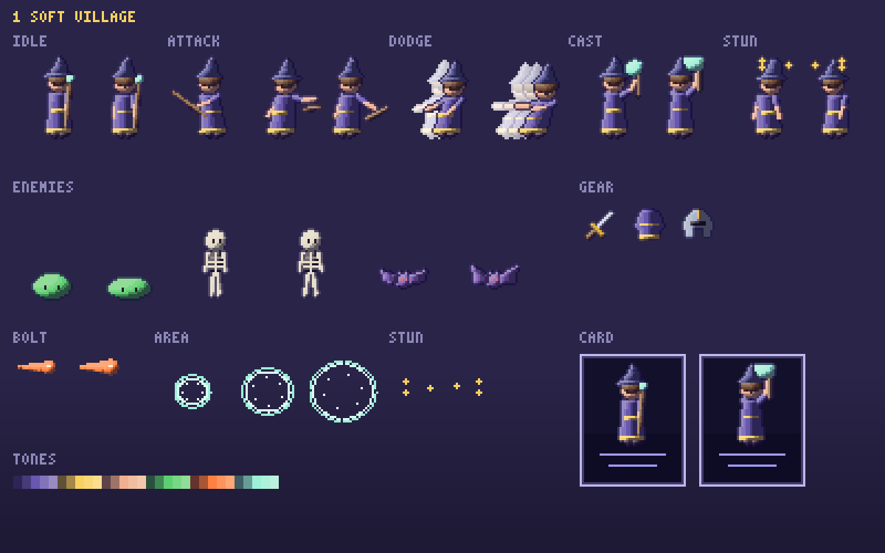
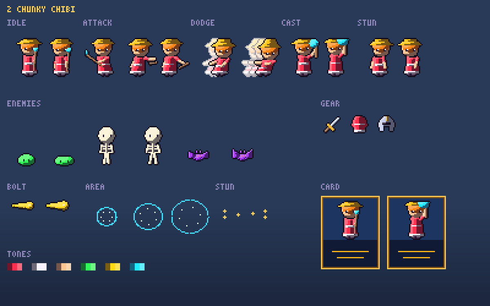
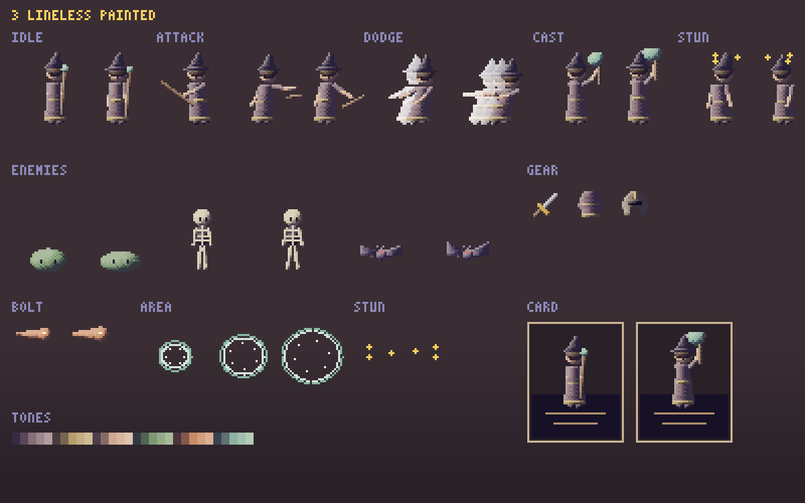
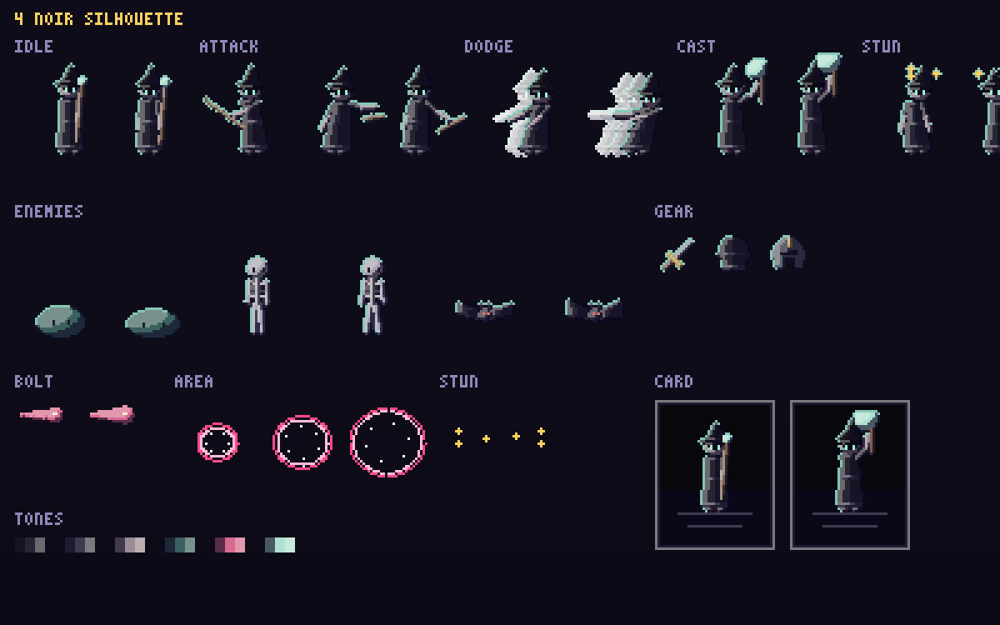
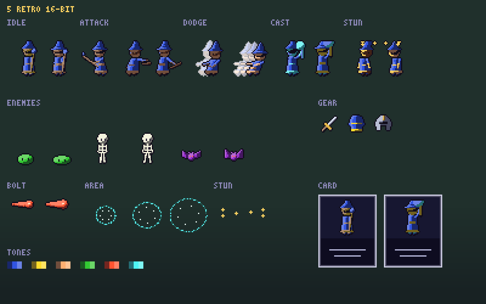
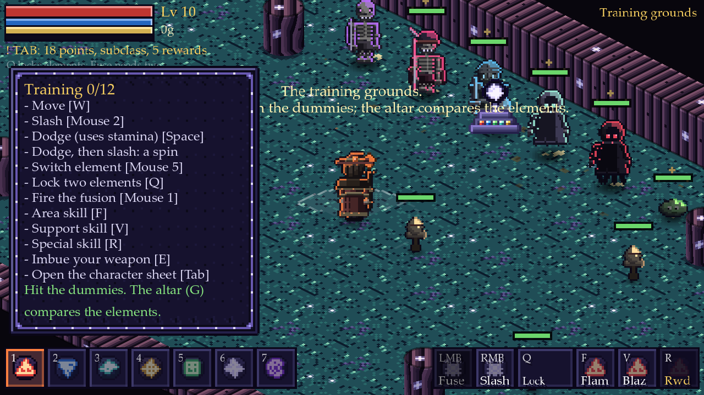
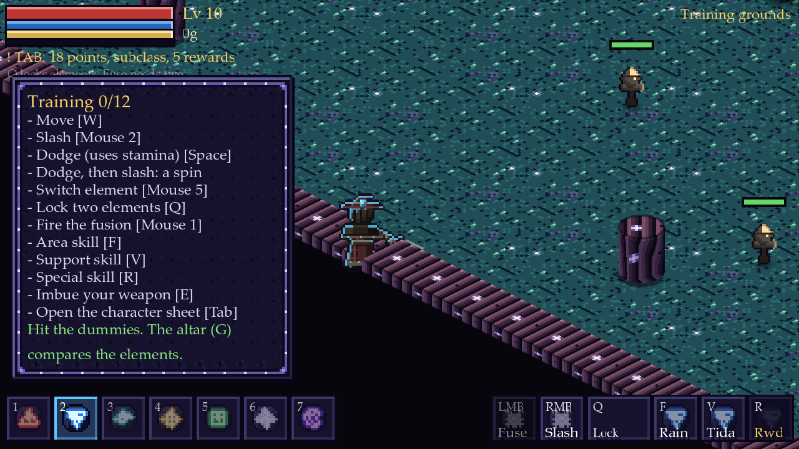
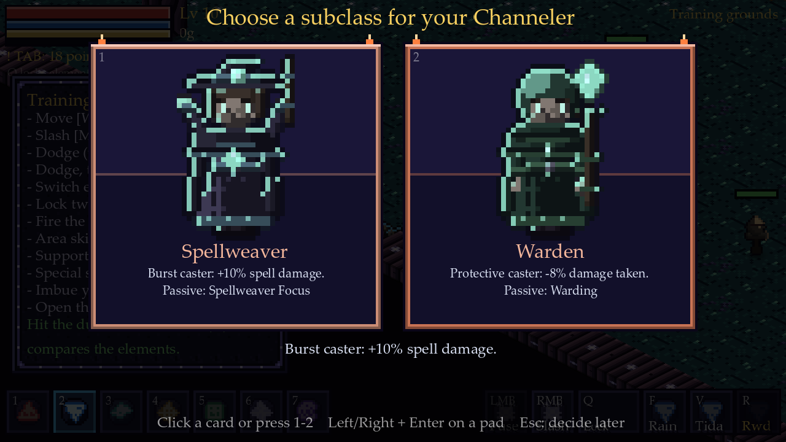

# Five art styles for the sprites

Status: **4 Noir Silhouette was picked ("colour affected by elements") and is applied**: see the section at the end. The other four boards stay
here as the record of what was offered.

Original proposal: **proposed, not applied.** The five boards below show the same things in five looks: a hero in idle, attack, dodge, cast and stunned
frames (with a dodge trail), three enemies (slime, skeleton, bat), three pieces of gear, a bolt, an area ring, stun stars and a class-card
mock-up. They are drawn by `tools/art/sprite_styles.py` (`python tools/art/sprite_styles.py [soft|chibi|painted|noir|retro]`), at the new,
smaller hero size (about 15% below the current 38 px figure). The world, the UI and the runes stay Moonlit Glyphwork; only the sprites differ.

| # | Style | Board | Proportions | Shading | Outline | Palette | Hero size |
|---|---|---|---|---|---|---|---|
| 1 | **Soft Village** |  | natural, about 4 heads | 5 soft tones, hue-shifted shadows | selective (a deep shade of the colour it borders) | jewel tones | 32 px |
| 2 | **Chunky Chibi** |  | big head, small body, about 2.5 heads | 3 flat bold tones | thick dark ink line | bright, saturated, high contrast | 26 px |
| 3 | **Lineless Painted** |  | slim, about 5 heads | 5 tones with dithered gradients | none: shapes are told apart by value | muted, earthy, hand-painted | 34 px |
| 4 | **Noir Silhouette** |  | tall and lean, about 6 heads | 3 hard tones, near-black bodies | none, plus a hard coloured rim light | almost monochrome with one glowing accent | 36 px |
| 5 | **Retro 16-bit** |  | tiny, about 3 heads | 3 tones, at most 6 colours a sprite | one-pixel dark outline | limited console palette | 24 px |

## How each one reads in the game

* **1 Soft Village** is where the game is now (heroes and enemies on one rig, soft shading), made 15% smaller. Least work, most detail, best for faces and
  clothes; the smaller size costs some of that detail.
* **2 Chunky Chibi** is the easiest to read at a glance and the most forgiving at a small size: a big head carries the face, three tones are quick to draw
  and animate, the thick line keeps every sprite clear on the dark floors. Cute rather than moody.
* **3 Lineless Painted** is the most atmospheric and the most different from the UI; it needs the most care to keep sprites readable on the busy floor
  tiles, and dithered gradients animate with some shimmer.
* **4 Noir Silhouette** makes the magic pop (the element colours are the only bright things) and suits the dark world best; faces carry little, so
  characters are told apart by silhouette and gear.
* **5 Retro 16-bit** is the cheapest to animate (few colours, small frames, hard clusters) and the strongest nostalgia, but the least room for detail:
  classes and gear are told apart by colour more than by shape.

## What happens when one is picked

The chosen style is applied to everything that moves, in this order, each step ending with the self-tests, the art gate and a screenshot:

1. **Rig and palette:** the hero rig (`gen_heroes.py`), the humanoid enemies (`gen_enemies.py`), the other monsters and bosses, gear icons (`gen_items.py`).
2. **Animations** for the hero: idle, walk, attack, dodge roll, swirl attack (dodge + attack), casting with an element, hurt and stunned; the class and
   subclass selection cards get a looping idle (and a cast on hover); monsters get idle, walk, attack and stun.
3. **Effects:** element bolts with trails and impacts, area spells (a charge circle that fills during the wind-up, a burst, a lingering pool) and a stun
   effect (orbiting stars and a ring) on any stunned enemy or hero.
4. **The art gate** (`check_art.py`) learns the new style's rules.

## Done now, without waiting for the pick

The gameplay changes asked for with these styles are in the game already: base melee reach +10%, ranged shots 2.3 times slower, wind-ups before areas
and specials (cancelled by a dodge), longer dodge and swirl-attack immunity, a roll that slips through ordinary enemies (not bosses, mini bosses or
terrain), and heroes and enemies drawn 15% smaller. The 15% is a scale applied while drawing: until the sprites are redrawn on the smaller grid it
shows some uneven pixels at some window sizes; the redraw in the chosen style removes that.

## Applied: Noir Silhouette, with colour that follows the element

* **Bodies are near-black.** Every palette colour of a hero, enemy or piece of gear is darkened and desaturated (`tools/art/noir.py`: half the
  saturation, 46% of the light, a breath of night blue) and shaded in three hard tones. Outlines are nearly black, tinted by what they border.
* **One glowing accent, the element's.** Eyes, gems, glints and a hard rim light on the lit upper-left edge take a single colour, the sprite's *glow*.
  For the hero it is the element currently selected (or the one the blade is coated with): press 1..7 and the whole figure re-lights in fire orange,
  water blue, air teal, mineral gold, earth green, light white or dark violet (martial: pale steel). For an enemy it is its own element: skeleton
  violet, bone duelist magenta, grave warden ice blue, ember matron fire orange, wraith teal, shade red; the other monsters keep the colour of what
  glows on them (eyes, crowns, slime shine) and their variant tint still shades them toward the variant's element.
  
* **Heroes have 21 poses** in a 40 x 38 cell (the figure is the middle 24 columns, the rest is room for swings and raised arms): 4 walk, 2 idle,
  3 attack (wind-up, strike, follow-through), 2 dodge (crouch, tuck), 4 swirl, 3 cast (arms rising), 2 stun, 1 hurt. Arms are drawn along an angle, weapons
  are drawn upright and turned about the hand, legs spread, the body crouches: every part of every class and piece of gear follows the pose.
  `HeroComposer.CLIPS` names the runs; `SpriteAnim.set_clip` plays them; `Player._update_sprite` chooses: swirl, dodge, hurt, cast (a charging or just
  cast area, buff or special), attack (a slash, a bolt or a fusion), walk, idle.
* **Class and subclass cards are alive**: each hero breathes (the idle poses) and casts while its card is hot (hovered or selected): `HeroDoll`.
  
* **Stunned enemies** carry three stars circling over their heads (`SkillFx.stun_id`, a picture that stands on the enemy so the stars float over it
  in both views). Areas charge with a ring round the hero and a circle where they will land (`SkillFx.charge`), then burst in their element's rune
  circle; bolts, rings and rune circles were already in element colours.
* **Gear icons** are dark metal and cloth with a pale steel rim, and glowing gems in their family's colour.
* **Rules the art gate checks**: monsters and bosses are mostly dark (at least half their pixels), hero parts keep the region/shade encoding at 21 poses,
  no part touches its frame's edge cells, no pure black or white.

### Known gaps
* The hero is still drawn at 0.85 scale (`Player.SPRITE_SCALE`), not redrawn on a smaller grid, so some window sizes show uneven pixels.
* Remote players in multiplayer glow in the default teal (the look sent over the network carries no glow).
* The stun, hurt and swirl poses exist for every hero but only the swirl, hurt, dodge, cast and attack are triggered in play: the hero cannot be stunned.
* Enemy attack animations are the walk cycle plus the red telegraph; only humanoid enemies have more than four frames in their strip (four).
